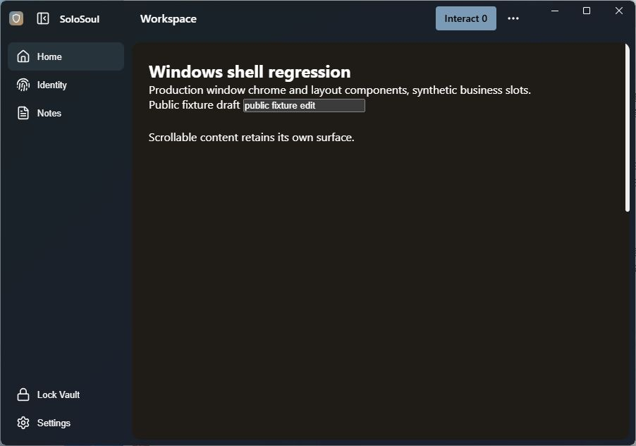
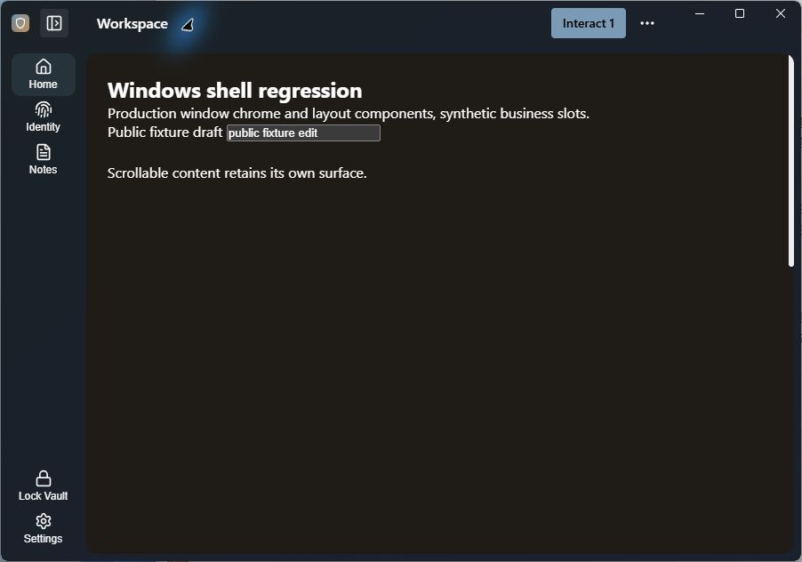
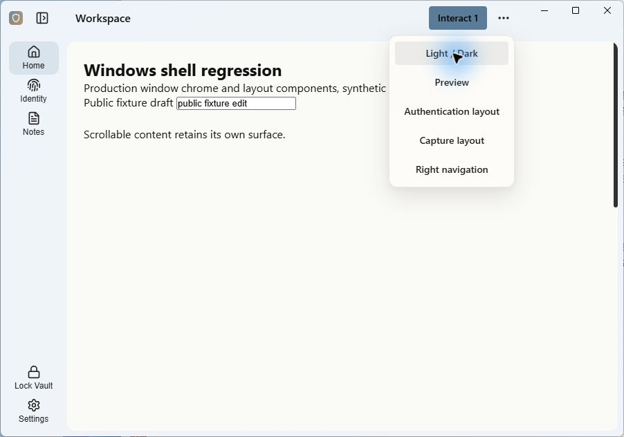
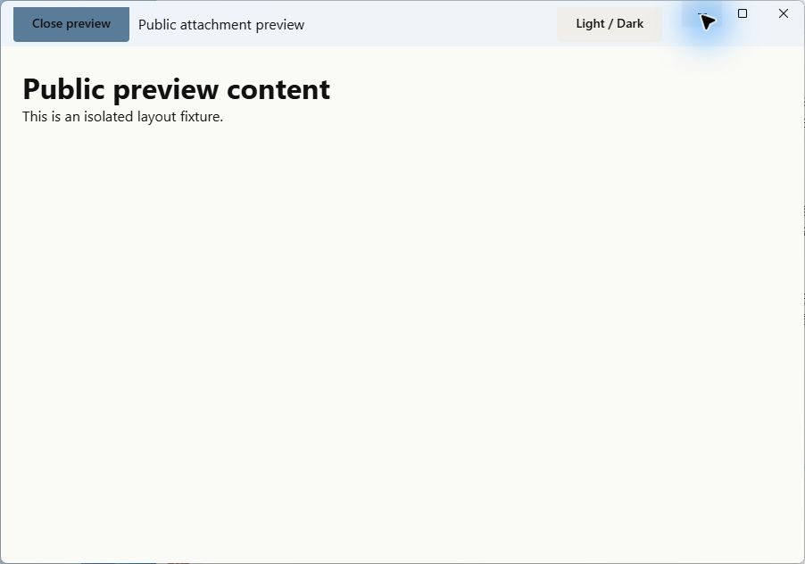
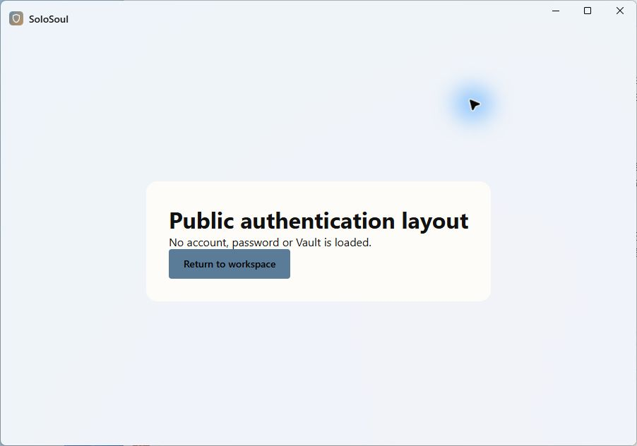

# RF-1144 Windows 一体顶栏验收

2026-10-13 开始，2026-10-14 完成。分支 `codex/windows-integrated-titlebar-ui`，起点 `229829897`。本项实现和日志采用一个提交，其他 11 项及整体 goal 继续暂停。

52px 顶栏统一应用图标、固定侧栏开关、页面标题与操作区域，保留 Windows 原生按钮和 Snap。顶栏/导航直接使用 Mica，正文使用独立主题表面及 12px 圆角；侧栏展开 186px、折叠 96px。认证布局、附件预览、四种导航方向与窄窗口同步接入；失败撤除原生窗框并回退旧布局。

## 验证结果

- TypeScript、ESLint、本项源码格式、生产构建、IPC/ACL 检查通过。ESLint 保留既有 `syncStore.ts` unused event 警告；全库 Prettier 检查报告 875 项既有格式问题，本项修改/新增源码单独检查通过，没有格式化无关文件。
- Node 257 通过、0 失败、1 项按既有 Windows 条件跳过。完整 Vitest 265 文件、2369 用例通过；使用四个互不重叠的顺序分片，合并覆盖率为 statements 85.98%、branches 73.42%、functions 80.96%、lines 87.86%，按原门槛 80/70/80/80 验收。保留原来的测试隔离及 15 秒测试超时。
- 原三次单进程全套尝试的用例断言均通过，但存在工作进程启动错误，退出 1，不计为成功。早期第一分片因直接套用全库覆盖率门槛退出 1，也如实保留。最终四个分片及合并均退出 0，不跳过失败文件。
- 浏览器所选 94 个场景初次 90 通过、4 失败；三个启动等待超时原预算重跑通过，一个过时的 Mica 叠色断言按透明导航契约修正。定向复验 5 个场景通过（含一个重叠用例）。生产启动/静态说明回归 32 个场景通过。
- 隔离原生例程构建、严格 Clippy、18 项窗口测试和 Rust 格式通过。真实 Windows 11、96DPI 验证网页点击、折叠、主题、原生最大化/恢复、操作收纳、预览、最小化/恢复、认证布局和关闭；记录 `native-close`、`destroyed` 及退出 0。最终运行绑定 97 份前端源码与 9 份原生构建输入的 SHA-256。
- 用户人工确认“拖动成功，Snap 出现”，原生读取证明位移 (+30,-11)，外框尺寸不变。早期夹具未导入 `startup.css`，只能证明输入/状态；最终夹具已加载生产透明底板，实际 HTML/body/顶栏/导航透明、正文实色，单独补齐 Mica 视觉验收。

## 截图采集差异与边界

WGC 截图在打开预览时漏采 DWM 按钮图标，用户明确确认“三个图标正常可见”。最终例程中按钮点击正常，最小化/恢复后截图也包含三个图标。已撤回因此增加的重绘、顶栏切换材质刷新、CSS 切口和临时 IPC 跟踪，不将采集差异记录成已修复的产品绘制缺陷。

例程不加载账户、密码、Vault 或正式 setup；其显示命令只显示隔离窗口，不覆盖正式应用的持久化窗口状态恢复。跨 DPI/跨屏、旧 Windows 材质、高对比度/关闭透明度和原生全屏矩阵未实测，原 RF-121 等待验收项继续暂停。

[结构化结果](result.json)记录检查命令、退出码、来源和未测范围；[原件索引](index.json)为[日志归档](raw.zip)中每个成员记录长度和 SHA-256，归档后逐成员回读验证。不包含 WebView profile、可执行文件、依赖、模型、账户或私人应用截图。

## 最终公开窗口

